# Algorithm2026

고급알고리즘(2026, 목 U407) 과제 저장소입니다. 아래 링크와 스크린샷은 `main` 브랜치의 파일을 바로 열기 때문에, 클릭하면 항상 최신 버전을 확인할 수 있습니다.

| 과제 | 내용 | 코드 | 결과 |
|---|---|---|---|
| Homework 1 | Selection, Bubble, Insertion, Merge, Quick, Heap Sort | [hw1_sorting](./homework/hw1_sorting) | [스크린샷](#homework-1-sorting) |
| Homework 2 | Sorting Animation | [SortingAnimation.pde](./homework/hw2_sorting_animation/SortingAnimation/SortingAnimation.pde) | [YouTube](https://youtu.be/IPcKI3-0LUg) |
| Homework 3 | Binary Search Tree (insert, delete, search, inorder·preorder·postorder) | [BSTAnimation.pde](./homework/hw3_bst/BSTAnimation/BSTAnimation.pde) | [YouTube](https://youtu.be/h1nlurgHODQ) |
| 8장 실습 | 동적 프로그래밍: 피보나치 수, 행렬 경로, 조약돌 놓기 | [ch08_dynamic_programming](./homework/ch08_dynamic_programming) | [스크린샷](#8장-동적-프로그래밍) |
| 그래프 실습 | DFS, BFS | [graph_search](./homework/graph_search) | [스크린샷](#그래프-탐색-실습) |
| 숙제 (Breadth-First Search) | 너비 우선 탐색 | [BreadthFirstSearch.pde](<./homework/숙제 (Breadth-First Search)/BreadthFirstSearch/BreadthFirstSearch.pde>) | [실행 결과](#숙제-breadth-first-search) |
| 숙제 (Depth-First Search) | 깊이 우선 탐색 | [DepthFirstSearch.pde](<./homework/숙제 (Depth-First Search)/DepthFirstSearch/DepthFirstSearch.pde>) | [실행 결과](#숙제-depth-first-search) |

## Homework 1: Sorting

0~99 사이의 무작위 정수 16개를 정렬하면서 단계마다 배열 상태를 콘솔에 출력합니다. 스크린샷은 코드와 Processing 4.5.7에서 실제로 실행한 결과이며, 스크린샷을 클릭하면 코드 파일로 이동합니다.

| 정렬 | 평균 | 최악 | 핵심 아이디어 |
|---|---|---|---|
| [Selection](./homework/hw1_sorting/SelectionSort/SelectionSort.pde) | O(n²) | O(n²) | 남은 구간의 최댓값을 찾아 맨 끝과 교환 |
| [Bubble](./homework/hw1_sorting/BubbleSort/BubbleSort.pde) | O(n²) | O(n²) | 이웃끼리 비교해 큰 값을 뒤로 보냄 |
| [Insertion](./homework/hw1_sorting/InsertionSort/InsertionSort.pde) | O(n²) | O(n²) | 정렬된 앞쪽 구간에 다음 원소를 끼워 넣음 |
| [Merge](./homework/hw1_sorting/MergeSort/MergeSort.pde) | O(n log n) | O(n log n) | 반으로 나눠 정렬한 뒤 합침 |
| [Quick](./homework/hw1_sorting/QuickSort/QuickSort.pde) | O(n log n) | O(n²) | 기준(pivot)보다 작은 값과 큰 값으로 나눔 |
| [Heap](./homework/hw1_sorting/HeapSort/HeapSort.pde) | O(n log n) | O(n log n) | 최대 힙의 루트를 맨 뒤로 보내고 다시 힙으로 만듦 |

### Selection Sort

<a href="./homework/hw1_sorting/SelectionSort/SelectionSort.pde">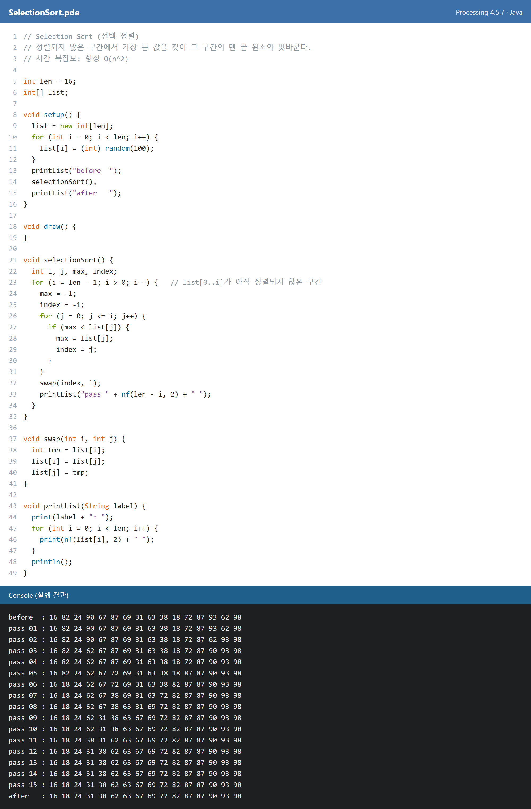</a>

### Bubble Sort

<a href="./homework/hw1_sorting/BubbleSort/BubbleSort.pde">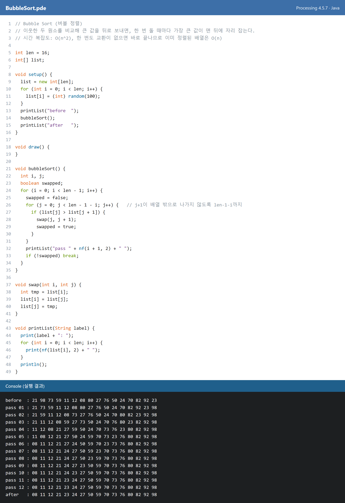</a>

### Insertion Sort

<a href="./homework/hw1_sorting/InsertionSort/InsertionSort.pde">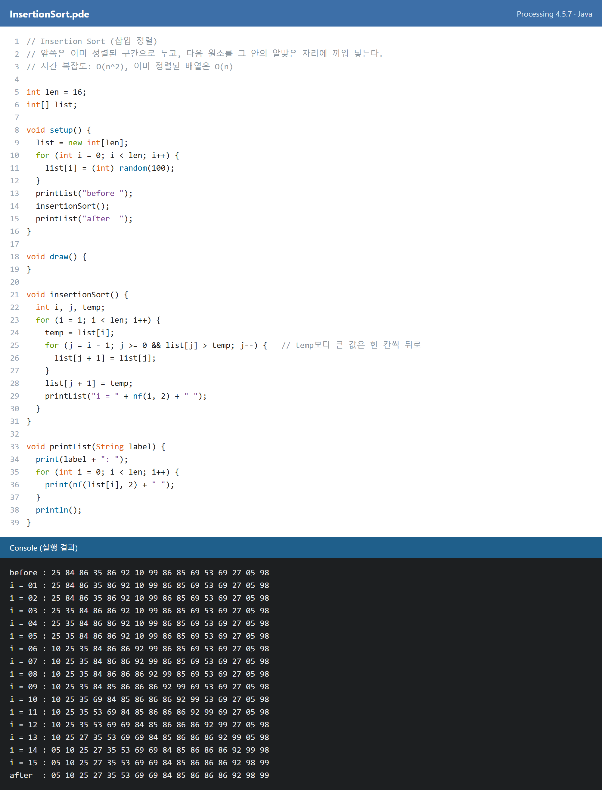</a>

### Merge Sort

<a href="./homework/hw1_sorting/MergeSort/MergeSort.pde">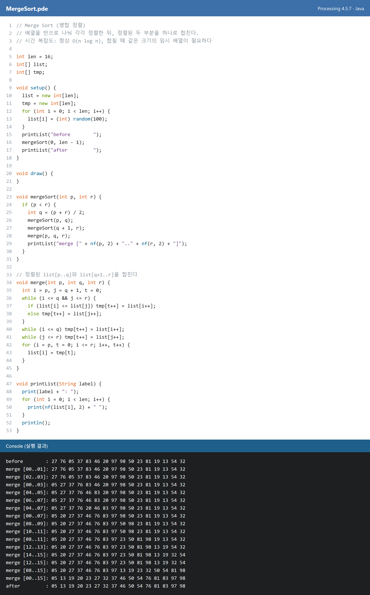</a>

### Quick Sort

<a href="./homework/hw1_sorting/QuickSort/QuickSort.pde">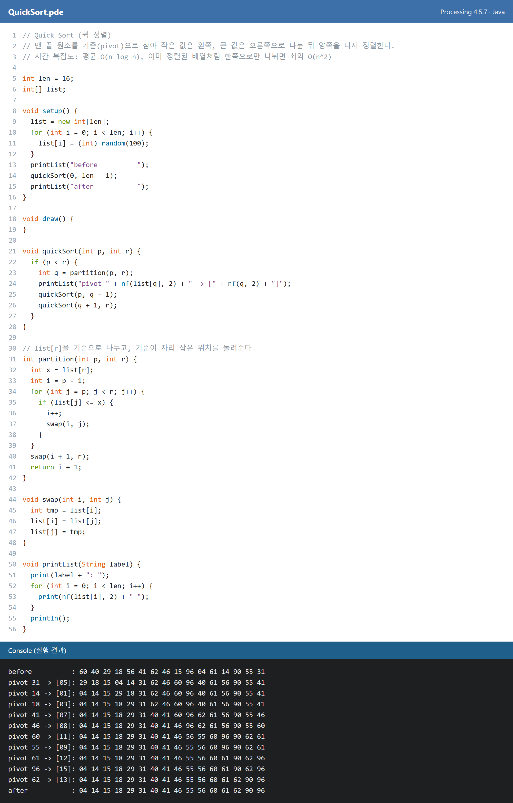</a>

### Heap Sort

<a href="./homework/hw1_sorting/HeapSort/HeapSort.pde">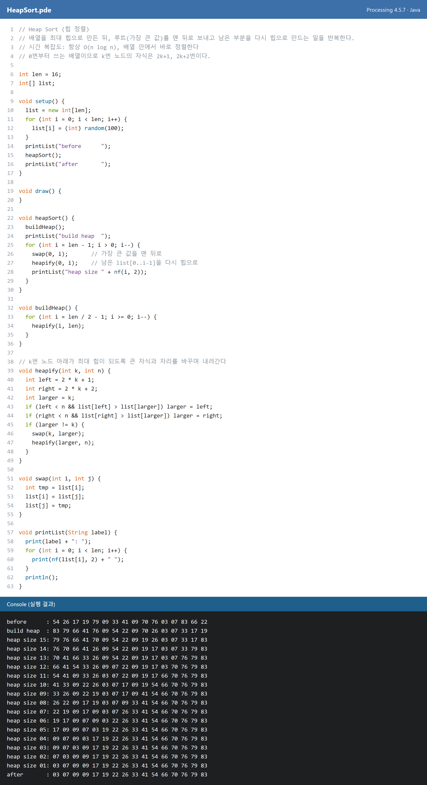</a>

## Homework 2: Sorting Animation

1~30을 무작위로 섞은 같은 배열을 Selection → Bubble → Insertion → Merge → Quick → Heap 순서로 정렬하는 과정을 막대로 보여 줍니다. 빨간 막대는 지금 비교하거나 옮기는 원소이고, 정렬이 끝나면 전체가 초록색으로 바뀝니다. 이미지를 클릭하면 영상이 열립니다.

[](https://youtu.be/IPcKI3-0LUg)

코드: [SortingAnimation.pde](./homework/hw2_sorting_animation/SortingAnimation/SortingAnimation.pde)

## Homework 3: Binary Search Tree

키 `50, 30, 70, 20, 40, 60, 80, 35, 45, 65`를 차례로 삽입한 뒤 검색(45, 55), Inorder·Preorder·Postorder 순회, 삭제(20: 리프, 60: 자식 하나, 50: 자식 둘)를 보여 줍니다. 노란색은 지나가는 노드, 초록색은 새 노드·찾은 노드·방문한 노드, 빨간색은 삭제할 노드, 주황색은 대신 올라오는 노드입니다. 이미지를 클릭하면 영상이 열립니다.

[](https://youtu.be/h1nlurgHODQ)

코드: [BSTAnimation.pde](./homework/hw3_bst/BSTAnimation/BSTAnimation.pde)

## 8장 동적 프로그래밍

피보나치 수, 행렬 경로, 조약돌 놓기 문제를 Processing으로 풀었습니다. 스크린샷은 코드와 Processing 4.5.7에서 실제로 실행한 결과이며, 스크린샷을 클릭하면 코드 파일로 이동합니다.

### 피보나치 수

앞의 두 수를 더해 다음 수를 구하는 과정을 10번 반복합니다. 이미 구한 두 값만 저장해 두고 다시 쓰기 때문에 재귀 호출처럼 같은 값을 여러 번 계산하지 않습니다.

<a href="./homework/ch08_dynamic_programming/Fibonacci/Fibonacci.pde">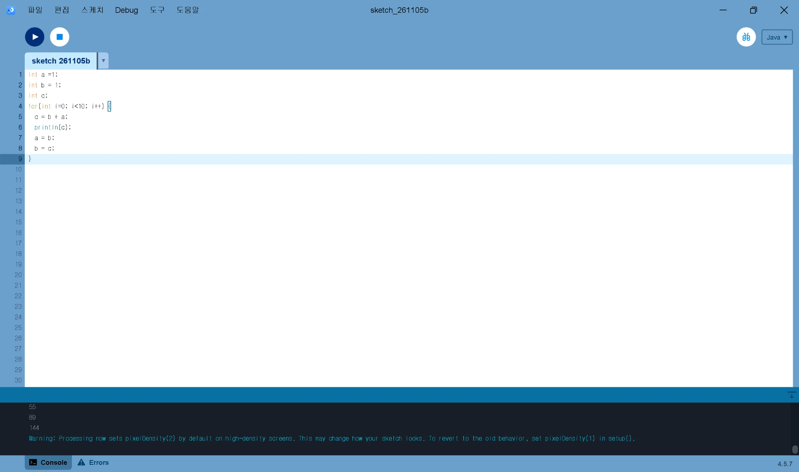</a>

두 번째 버전은 이웃한 두 수의 비(c / b)도 함께 출력합니다. 반복할수록 이 값은 황금비(약 1.618)에 가까워집니다.

<a href="./homework/ch08_dynamic_programming/FibonacciRatio/FibonacciRatio.pde">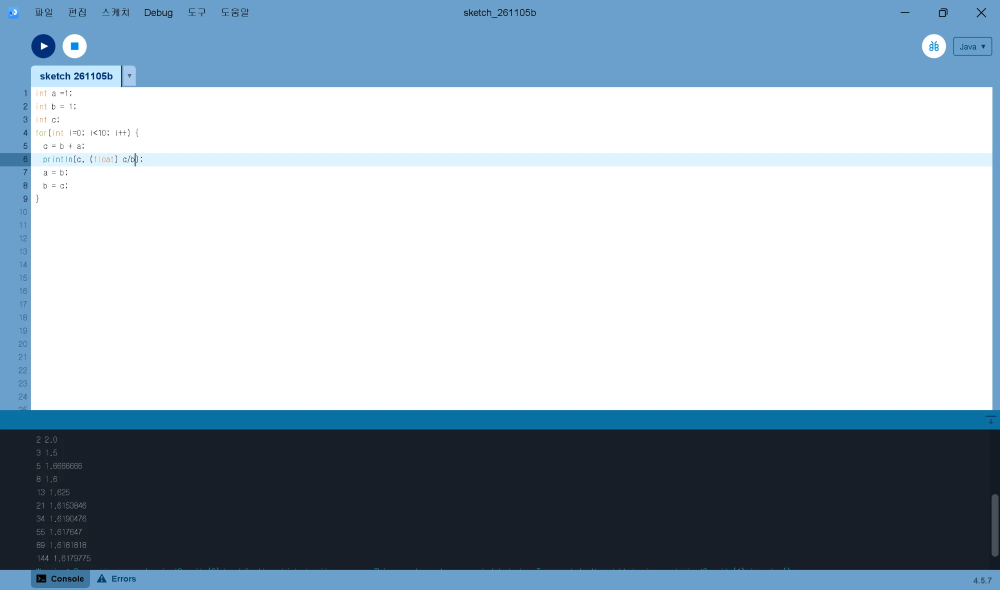</a>

### 행렬 경로

3×3 행렬의 각 칸에 0~9 난수를 넣고, 왼쪽 위 칸에서 오른쪽 아래 칸까지 오른쪽이나 아래로만 움직일 때 지나는 칸의 합 중 최솟값을 구합니다. `matrixPath(i, j)`는 (i, j) 칸까지 오는 최소 합이며, 위 칸 `matrixPath(i-1, j)`와 왼쪽 칸 `matrixPath(i, j-1)` 중 작은 값에 이번 칸의 값을 더해 구합니다. 결과를 저장하지 않는 재귀 버전이라 같은 칸을 여러 번 다시 계산합니다. 스크린샷의 행렬에서는 9 → 2 → 2 → 6 → 1 경로의 합 20이 최솟값입니다.

<a href="./homework/ch08_dynamic_programming/MatrixPath/MatrixPath.pde">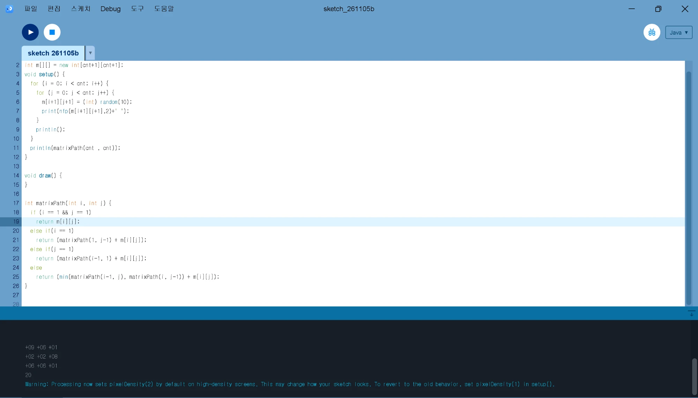</a>

### 조약돌 놓기

3×n 테이블의 각 칸에 -9~9 난수를 넣고, 가로나 세로로 붙은 두 칸에 동시에 놓지 않으면서 열마다 적어도 하나씩 조약돌을 놓아 점수 합을 최대로 만드는 문제입니다. 교재의 `pebbleSum(n)` 의사코드를 그대로 옮겼습니다. `peb[i][p]`는 i열을 패턴 p(1: 위, 2: 가운데, 3: 아래, 4: 위+아래)로 놓았을 때 i열까지의 최대 점수 합이고, 바로 앞 열에서 양립하는 패턴의 값 중 가장 큰 것에 이번 열의 점수를 더해 구합니다. 실행하면 입력 테이블, `peb` 테이블, 답 순서로 출력하며 시간 복잡도는 O(n)입니다.

<a href="./homework/ch08_dynamic_programming/PebbleSum/PebbleSum.pde">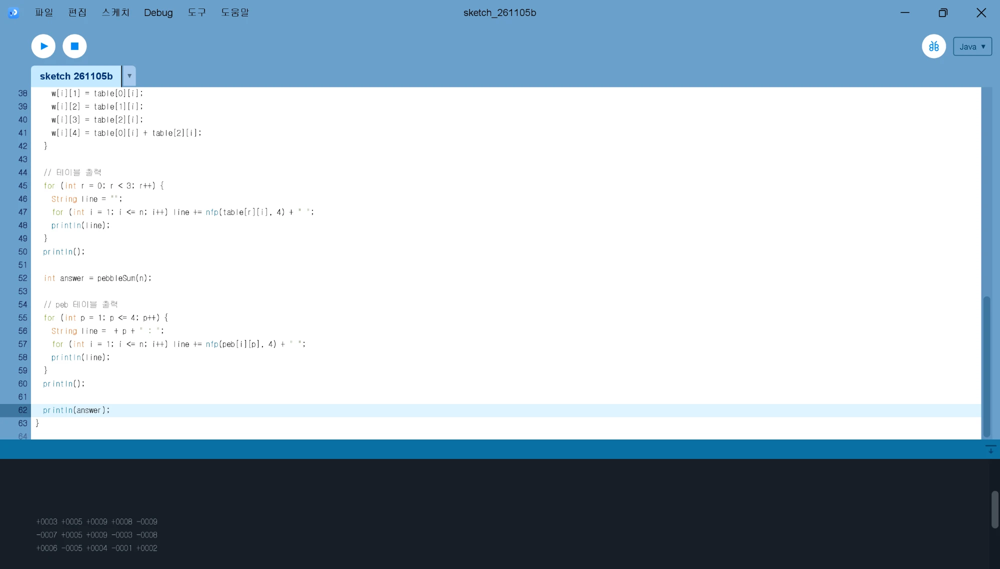</a>

## 그래프 탐색 실습

정점 8개, 간선 9개인 무방향 그래프를 1번 정점부터 번호가 작은 이웃 먼저 DFS와 BFS로 탐색합니다. 주황색 선은 탐색 트리 간선, `#k`는 방문 순서, 빨간 정점은 마지막에 방문한 정점입니다. BFS는 큐에 넣을 때 `visited[v]`를 YES로 바꿉니다(강의 자료 19쪽 정정). 스크린샷을 클릭하면 코드 파일로 이동합니다.

### DFS

방문 순서: 1 -> 2 -> 7 -> 6 -> 8 -> 3 -> 4 -> 5

<a href="./homework/graph_search/DFS/DFS.pde">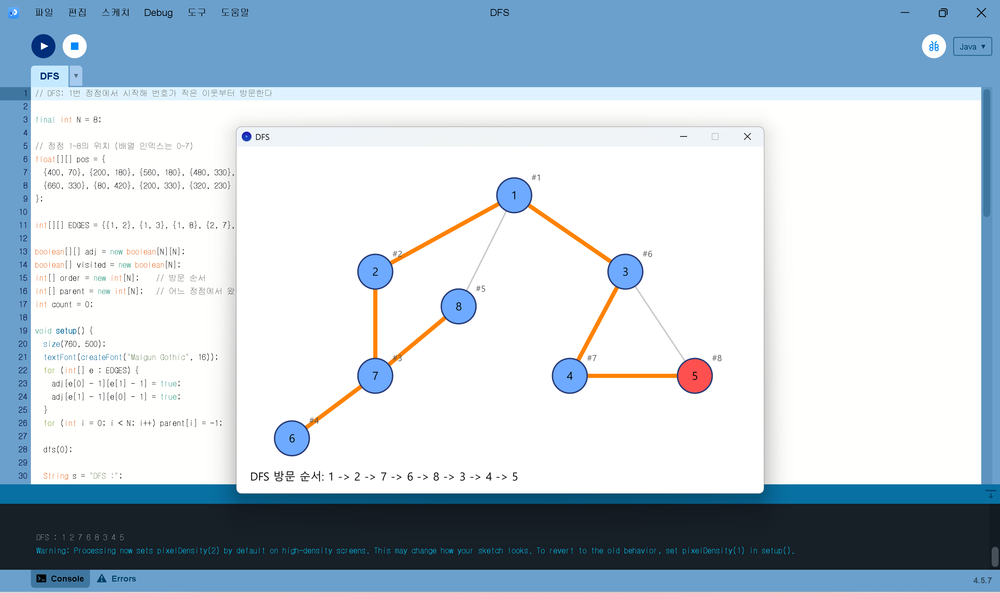</a>

### BFS

방문 순서: 1 -> 2 -> 3 -> 8 -> 7 -> 4 -> 5 -> 6

<a href="./homework/graph_search/BFS/BFS.pde">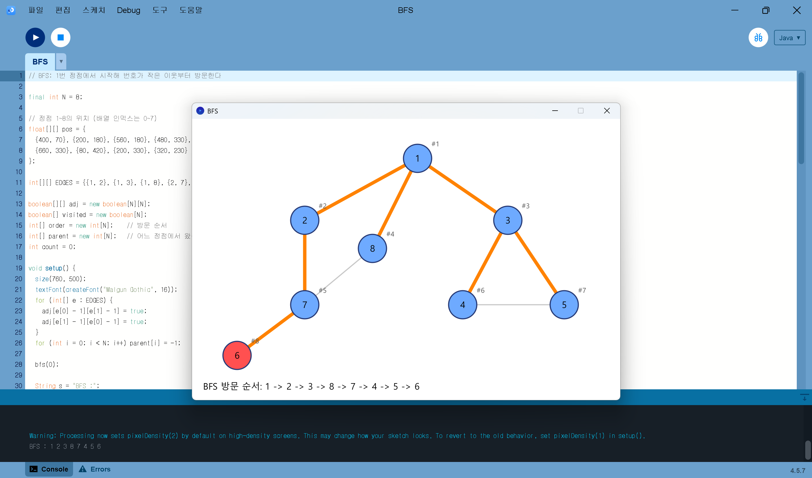</a>

## 숙제 (Breadth-First Search)

참고: [Breadth First Search or BFS for a Graph](https://www.geeksforgeeks.org/dsa/breadth-first-search-or-bfs-for-a-graph/)

정점 5개, 간선 (1,2), (1,0), (2,0), (2,3), (2,4)로 인접 리스트를 만들고 0번 정점부터 큐로 탐색합니다. 이웃은 큐에 넣을 때 방문 표시를 하고, 큐에서 꺼낸 순서대로 결과에 넣습니다. 시간 복잡도는 O(V + E)입니다.

코드: [BreadthFirstSearch.pde](<./homework/숙제 (Breadth-First Search)/BreadthFirstSearch/BreadthFirstSearch.pde>)

```
0 1 2 3 4
```

## 숙제 (Depth-First Search)

참고: [Depth First Search or DFS for a Graph](https://www.geeksforgeeks.org/dsa/depth-first-search-or-dfs-for-a-graph/)

같은 그래프를 0번 정점부터 재귀로 탐색합니다. 정점에 들어가면 방문 표시를 하고 결과에 넣은 뒤, 방문하지 않은 이웃으로 내려갑니다. 시간 복잡도는 O(V + E)입니다.

코드: [DepthFirstSearch.pde](<./homework/숙제 (Depth-First Search)/DepthFirstSearch/DepthFirstSearch.pde>)

```
0 1 2 3 4
```

## 수업 실습

- [sellection_1.pde](./homework/sellection_1/sellection_1.pde): 정수 100개를 선택 정렬하는 첫 실습입니다.
- [selection_2_sorting.pde (선택 정렬)](./homework/sellection_1/selection_2_sorting/selection_2_sorting.pde): 선택 정렬을 `intArr`, `printArr`, `selectionSorting` 함수로 나눈 버전입니다.
- [selection_2_sorting.pde (버블 정렬)](./homework/selection_2_sorting/selection_2_sorting.pde): 같은 이름의 스케치를 버블 정렬로 바꾼 버전입니다.


