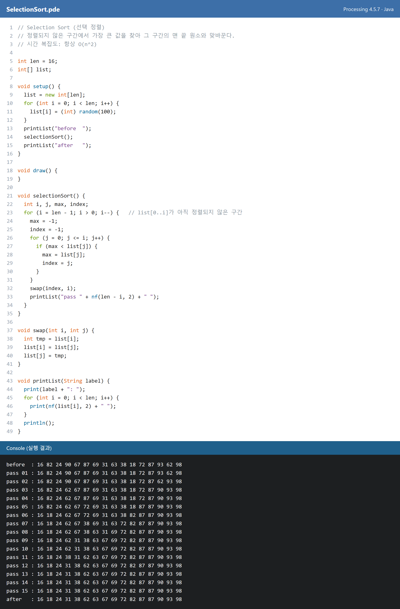
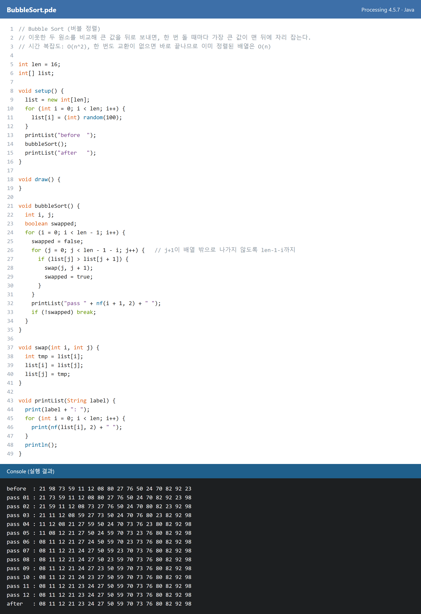
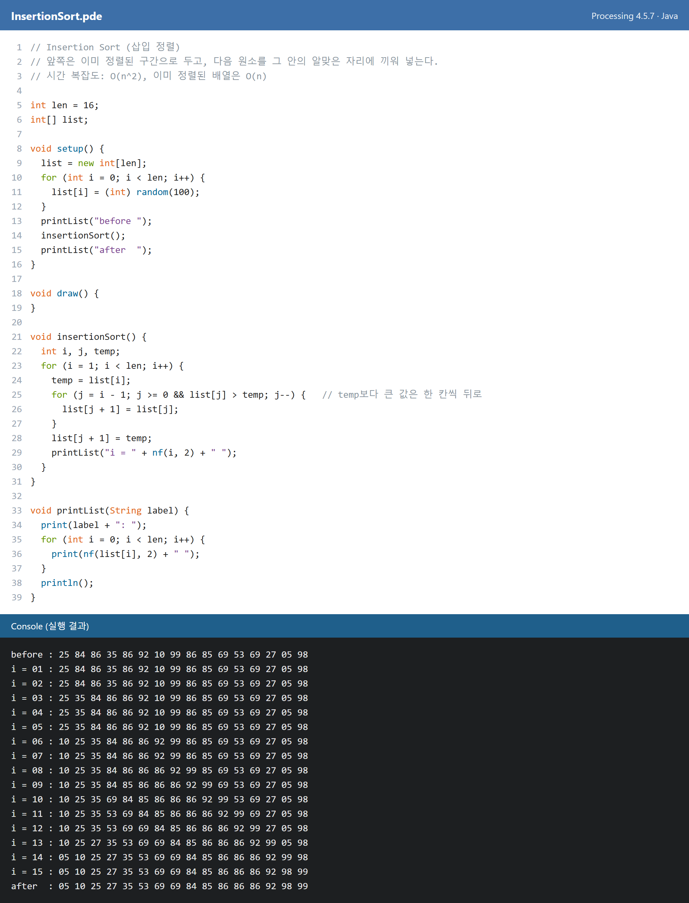
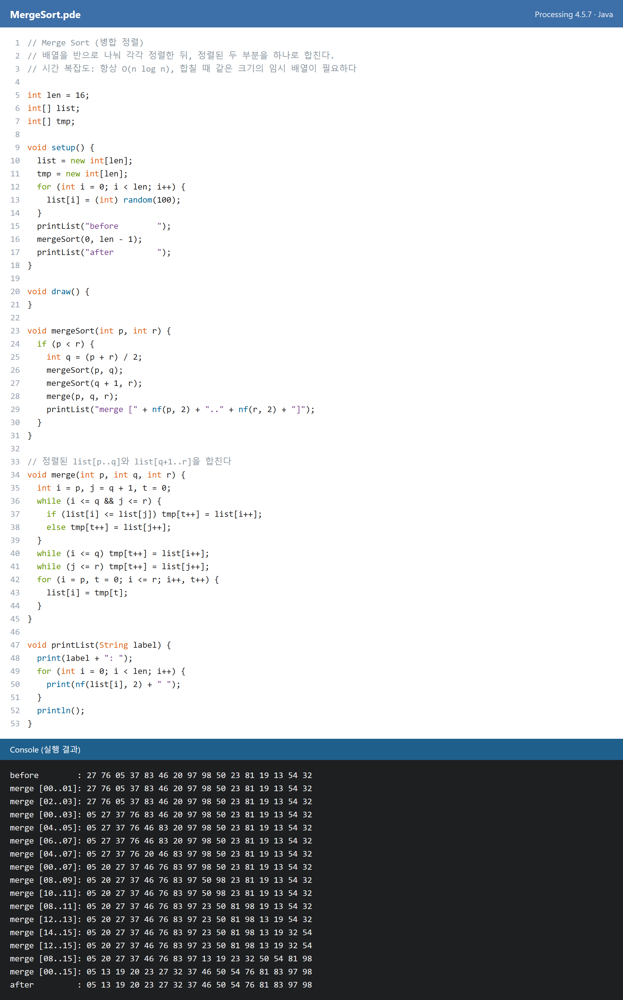
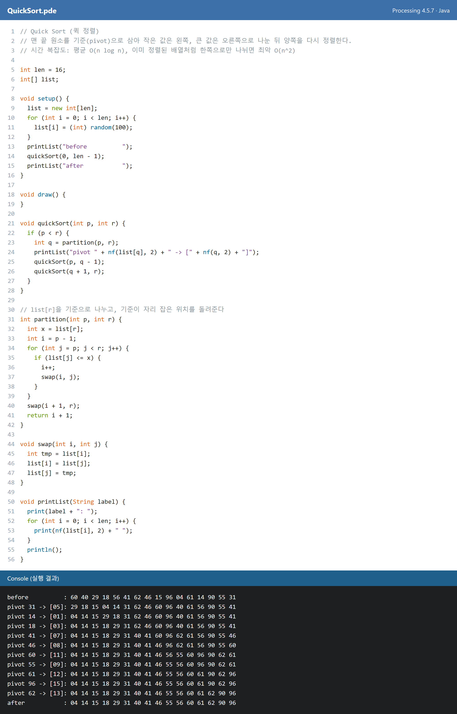
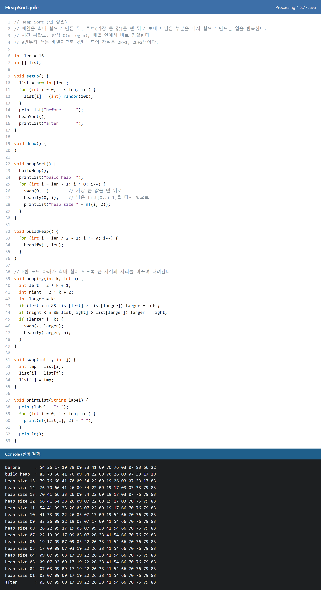

# Algorithm2026

고급알고리즘(2026, 목 U407) 과제 저장소입니다. 아래 링크와 스크린샷은 `main` 브랜치의 파일을 바로 열기 때문에, 클릭하면 항상 최신 버전을 확인할 수 있습니다.

| 과제 | 내용 | 코드 | 결과 |
|---|---|---|---|
| Homework 1 | Selection, Bubble, Insertion, Merge, Quick, Heap Sort | [hw1_sorting](./homework/hw1_sorting) | [스크린샷](#homework-1-sorting) |
| Homework 2 | Sorting Animation | [SortingAnimation.pde](./homework/hw2_sorting_animation/SortingAnimation/SortingAnimation.pde) | [YouTube](https://youtu.be/IPcKI3-0LUg) |
| Homework 3 | Binary Search Tree (insert, delete, search, inorder·preorder·postorder) | [BSTAnimation.pde](./homework/hw3_bst/BSTAnimation/BSTAnimation.pde) | [YouTube](https://youtu.be/h1nlurgHODQ) |

## Homework 1: Sorting

0~99 사이의 무작위 정수 16개를 정렬하면서 단계마다 배열 상태를 콘솔에 출력합니다. 스크린샷은 코드와 Processing 4.5.7에서 실제로 실행한 결과이며, 스크린샷을 클릭하면 코드 파일로 이동합니다.

| 정렬 | 평균 | 최악 | 핵심 아이디어 |
|---|---|---|---|
| [Selection](./homework/hw1_sorting/SelectionSort/SelectionSort.pde) | O(n²) | O(n²) | 남은 구간의 최댓값을 찾아 맨 끝과 교환 |
| [Bubble](./homework/hw1_sorting/BubbleSort/BubbleSort.pde) | O(n²) | O(n²) | 이웃끼리 비교해 큰 값을 뒤로 보냄 |
| [Insertion](./homework/hw1_sorting/InsertionSort/InsertionSort.pde) | O(n²) | O(n²) | 정렬된 앞쪽 구간에 다음 원소를 끼워 넣음 |
| [Merge](./homework/hw1_sorting/MergeSort/MergeSort.pde) | O(n log n) | O(n log n) | 반으로 나눠 정렬한 뒤 합침 |
| [Quick](./homework/hw1_sorting/QuickSort/QuickSort.pde) | O(n log n) | O(n²) | 기준(pivot)보다 작은 값과 큰 값으로 나눔 |
| [Heap](./homework/hw1_sorting/HeapSort/HeapSort.pde) | O(n log n) | O(n log n) | 최대 힙의 루트를 맨 뒤로 보내고 다시 힙으로 만듦 |

### Selection Sort

### Bubble Sort

### Insertion Sort

### Merge Sort

### Quick Sort

### Heap Sort

## Homework 2: Sorting Animation

1~30을 무작위로 섞은 같은 배열을 Selection → Bubble → Insertion → Merge → Quick → Heap 순서로 정렬하는 과정을 막대로 보여 줍니다. 빨간 막대는 지금 비교하거나 옮기는 원소이고, 정렬이 끝나면 전체가 초록색으로 바뀝니다. 이미지를 클릭하면 영상이 열립니다.

코드: [SortingAnimation.pde](./homework/hw2_sorting_animation/SortingAnimation/SortingAnimation.pde)

## Homework 3: Binary Search Tree

키 `50, 30, 70, 20, 40, 60, 80, 35, 45, 65`를 차례로 삽입한 뒤 검색(45, 55), Inorder·Preorder·Postorder 순회, 삭제(20: 리프, 60: 자식 하나, 50: 자식 둘)를 보여 줍니다. 노란색은 지나가는 노드, 초록색은 새 노드·찾은 노드·방문한 노드, 빨간색은 삭제할 노드, 주황색은 대신 올라오는 노드입니다. 이미지를 클릭하면 영상이 열립니다.

코드: [BSTAnimation.pde](./homework/hw3_bst/BSTAnimation/BSTAnimation.pde)

## 수업 실습

- [sellection_1.pde](./homework/sellection_1/sellection_1.pde): 정수 100개를 선택 정렬하는 첫 실습입니다.
- [selection_2_sorting.pde (선택 정렬)](./homework/sellection_1/selection_2_sorting/selection_2_sorting.pde): 선택 정렬을 `intArr`, `printArr`, `selectionSorting` 함수로 나눈 버전입니다.
- [selection_2_sorting.pde (버블 정렬)](./homework/selection_2_sorting/selection_2_sorting.pde): 같은 이름의 스케치를 버블 정렬로 바꾼 버전입니다.

